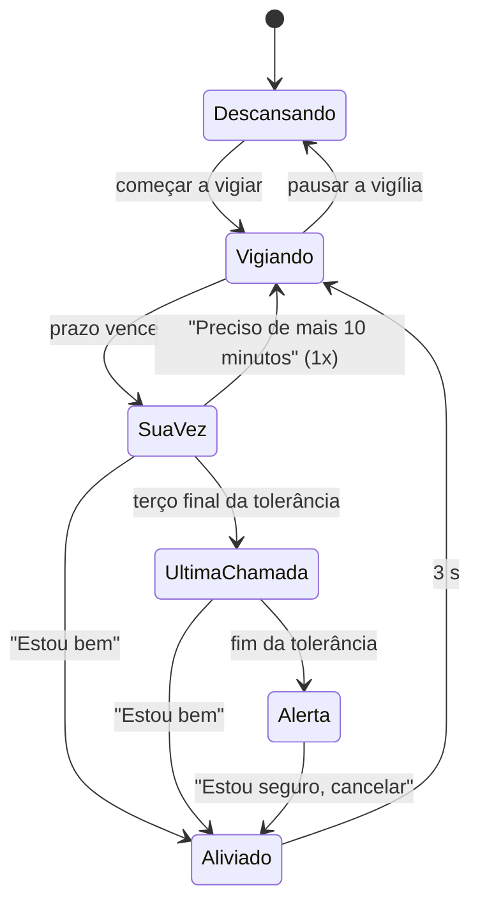
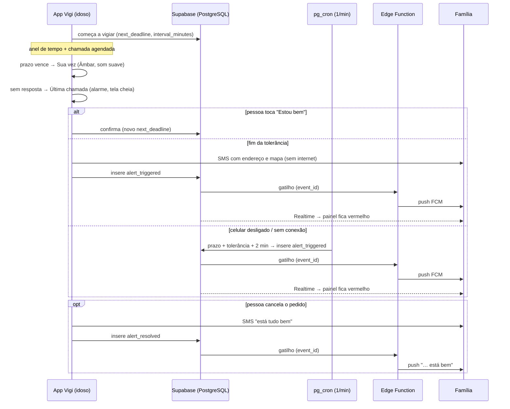
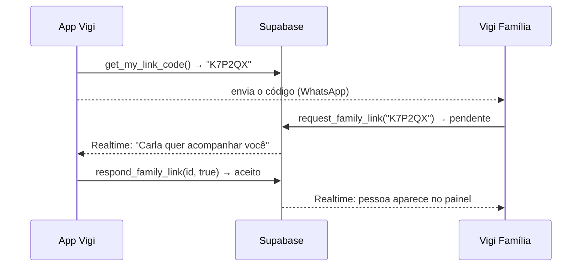

# Arquitetura do Vigi

## 1. Camadas (Clean Architecture + BLoC)

Cada funcionalidade em `lib/features/<nome>/` é dividida em três camadas, com
dependências apontando sempre para o domínio:

```
presentation/  →  domain/  ←  data/
(BLoC, páginas)   (entidades,   (datasources Supabase,
                   casos de uso,  modelos, repositórios
                   contratos)     concretos)
```

| Camada | Responsabilidade | Exemplo |
|---|---|---|
| **domain** | Regras de negócio puras, sem Flutter nem Supabase | `WellbeingStatus.evaluate`, `StartMonitoringUseCase` |
| **data** | Acesso ao Supabase e conversão de exceções em `Failure` | `CheckinRepositoryImpl`, `FamilyRemoteDataSourceImpl` |
| **presentation** | Estado da tela (BLoC/Cubit) e widgets | `CheckinBloc`, `FamilyDashboardPage` |

- Erros trafegam como `Either<Failure, T>` (pacote `fpdart`).
- Injeção de dependências com `get_it` em `lib/injection/injection_container.dart`.
- O painel web (`lib/family_web/`) reaproveita `auth` e `family` sem nenhum plugin
  de hardware — por isso compila para a web.

## 2. Serviços do núcleo (`lib/core/services/`)

| Serviço | Papel |
|---|---|
| `EmergencyDispatcher` | Envia SMS nativo aos contatos, um por vez (via `MainActivity.kt` / `SmsManager`), registra o alerta, aciona o push e envia o SMS de "está tudo bem" quando o pedido é cancelado |
| `AlarmService` | Sons e vibração de cada degrau: chamada, última chamada, alerta e confirmação |
| `NotificationService` | Um canal por degrau (vigília, chamada, última chamada, alerta), alarme exato agendado (`AlarmManager`), tela cheia e os botões "Estou bem" / "+10 min" |
| `CheckinMessages` | Os textos da escada, na voz do Vigi (usados na tela e nas notificações) |
| `SystemHealthService` | O que compromete a proteção: sem contatos, notificações, SMS, alarmes, tela cheia, localização, bateria, internet. Alimenta a faixa de saúde e a tela "Permissões" |
| `PushService` | Registra o token FCM do aparelho em `device_tokens` |
| `WidgetSyncService` | Envia ao widget o degrau atual e o horário do próximo check-in |
| `SecureLocalStorage` | Guarda a sessão no cofre do sistema (Keystore/Keychain) |
| `BrowserNotifier` | Notificação do navegador no painel web (import condicional) |

O app **não pede permissão ao abrir**. Cada uma é explicada na tela
"Permissões" (`lib/app/permissions_page.dart`) e só é pedida quando a pessoa
toca. No meio de um pedido de ajuda nenhum diálogo é aberto: sem a permissão
de localização, o aviso segue sem ela.

## 3. Fluxos principais

### 3.1 Dead man's switch (escada de estados)

`CheckinBloc` conduz a escada do Guia de Design. Os tempos vêm de
`CheckinSchedule` (domínio) e o servidor usa a mesma regra.



| Regra | Valor |
|---|---|
| Tolerância (prazo → aviso aos contatos) | `min(15 min, intervalo)` |
| Última chamada | terço final da tolerância, até 5 min |
| "Preciso de mais 10 minutos" | uma vez por ciclo |
| Margem do servidor | tolerância + 2 min |
| App aberto com o prazo vencido há muito tempo | ao menos 60 s para responder |



- O servidor só age se o app não o fez (tolerância + 2 min e verificação de
  alerta já registrado).
- A confirmação funciona **sem internet**: o ciclo local recomeça e o app reenvia
  ao servidor a cada 30 s.
- Cada evento gera **um único push**: a Edge Function "reivindica" o evento
  (`checkin_events.notified_at`) antes de enviar. O "está tudo bem" só sai se a
  família chegou a receber o alerta.
- Se a pessoa confirmar enquanto o aviso está sendo enviado, o app manda em
  seguida o SMS de "está tudo bem".

### 3.2 Pedir ajuda (botão de pânico)

1. O botão exige **segurar por 3 segundos** (contagem 3, 2, 1 com vibração):
   toques rápidos não pedem ajuda por engano. Fica no rodapé de todas as abas.
2. `TriggerPanicUseCase` obtém a localização e registra `panic` em `checkin_events`.
3. `PanicBloc` envia o SMS **mesmo se o registro no servidor falhar**, e a tela
   mostra, contato a contato, quem recebeu.
4. O gatilho do banco chama a Edge Function (push) e o Realtime atualiza o painel.
5. Ao cancelar, os mesmos contatos recebem o SMS de "está tudo bem".

O widget da tela inicial **não tem** botão de pânico: um widget só entende
toques simples, e pedir ajuda exige segurar.

### 3.3 Vínculo familiar com consentimento



Criar e autorizar vínculos só é possível pelas funções do banco
(`SECURITY DEFINER`); o RLS permite ao cliente apenas **ler** e **remover** os
próprios vínculos. Assim, um familiar não consegue se autorizar sozinho.

### 3.4 Painel da família (não invasivo)

`FamilyDashboardCubit` assina, via Realtime, `monitoring_settings` e os últimos
20 eventos de cada pessoa autorizada. `WellbeingStatus.evaluate` (função pura,
testada) decide a situação:

| Situação | Regra |
|---|---|
| **Emergência** | Pânico ou alerta nas últimas 24 h sem check-in posterior |
| **Pausado** | Monitoramento desligado |
| **Atrasado** | Prazo vencido (o Vigi está chamando no celular) |
| **Tudo bem** | Monitoramento ativo dentro do prazo |

A localização só aparece no cartão durante uma emergência.

## 4. Banco de dados

| Tabela | Conteúdo | Quem lê |
|---|---|---|
| `profiles` | Nome, telefone, código Vigi | O próprio usuário e as pessoas vinculadas |
| `emergency_contacts` | Quem recebe o SMS | O próprio usuário |
| `monitoring_modes` | Rotina, Banho, Sono e personalizados | Todos (sistema) / dono |
| `monitoring_settings` | Estado do dead man's switch (`next_deadline`, `last_ping`) | Dono e familiares aceitos |
| `checkin_events` | check-in, pânico, alerta, resolução (+ localização) | Dono e familiares aceitos |
| `family_links` | Vínculos (pending / accepted / rejected) | As duas partes |
| `device_tokens` | Tokens FCM | Dono |

Todas as tabelas têm **Row Level Security**. Funções relevantes:

| Função | Uso |
|---|---|
| `check_expired_heartbeats()` | Executada pelo pg_cron a cada minuto; espera `least(interval_minutes, 15)` + 2 min além do prazo |
| `notify_on_alert()` | Gatilho que chama a Edge Function com o `event_id` (`panic`, `alert_triggered` e `alert_resolved`) |
| `get_my_link_code()`, `request_family_link()`, `respond_family_link()` | Vínculo com consentimento |
| `guardiao_health()` | Diagnóstico da infraestrutura (somente booleanos) |

## 5. Edge Function `notify-emergency-contacts`

- Entrada: `{ "event_id": "<uuid>" }` (gatilho do banco ou reforço do app) ou
  `{ "healthcheck": true }`.
- Carrega o evento com a *service role* — o chamador não consegue forjar alertas.
- Autentica no Google com a conta de serviço (`FIREBASE_SERVICE_ACCOUNT`, JSON
  puro ou base64) e envia pela **FCM HTTP v1**.
- Remove tokens inválidos e libera o evento para nova tentativa se nenhum envio
  der certo.
- Textos na voz do Vigi, pelo primeiro nome: "Lúcia pediu ajuda", "Lúcia não
  respondeu ao check-in", "Lúcia está bem".
- O "está tudo bem" usa o canal `vigi_tudo_bem` (sem alarme) e a mesma etiqueta
  do alerta, para substituí-lo na bandeja de notificações.

## 6. Sistema visual

O Guia de Design vive em `lib/core/theme/` e `lib/core/widgets/`:

| Arquivo | Conteúdo |
|---|---|
| `app_colors.dart` | Paleta com escalas tonais (`VigiColors`) |
| `vigi_tokens.dart` | Espaços, raios, áreas de toque e tempos de animação |
| `app_typography.dart` | Escala tipográfica (Nunito nos títulos e números, Atkinson Hyperlegible no texto) |
| `vigi_palette.dart` | Cores por tema (claro e noturno) como `ThemeExtension` |
| `vigi_state.dart` | Os sete estados e o estilo de cada um (anel, olhos, respiração) |
| `vigi_mascot.dart` | A coruja, desenhada em código (`CustomPainter`) |
| `status_ring.dart` | Anel de tempo |
| `app_primary_button.dart` | Botões (64 dp; 96 dp na chamada) |

Fora do Flutter, os mesmos valores estão em
`android/app/src/main/res/values/colors.xml`, e os vetores do ícone, da
notificação e do widget são gerados por `scripts/make_icons.py` a partir da
mesma geometria da coruja.

O widget Android (`GuardiaoWidgetProvider.kt`) lê o degrau gravado por
`WidgetSyncService` e escolhe fundo, coruja, textos e ação do toque: abre o app
na vigília e confirma o check-in ("Estou bem") na chamada.
